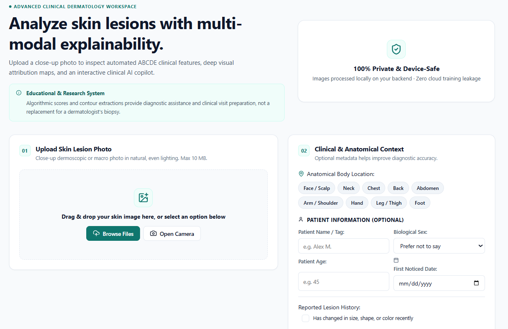
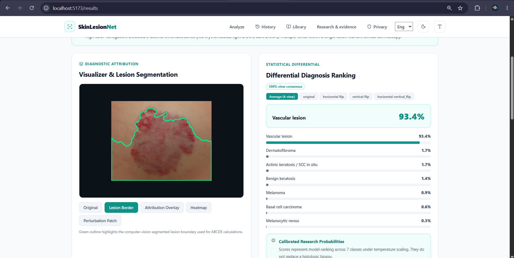
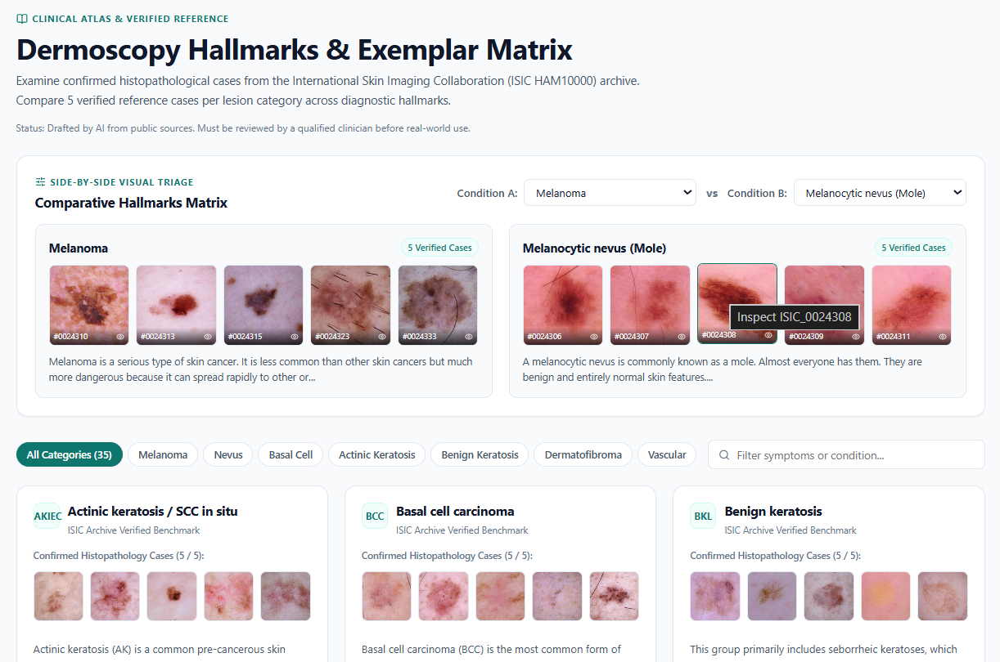
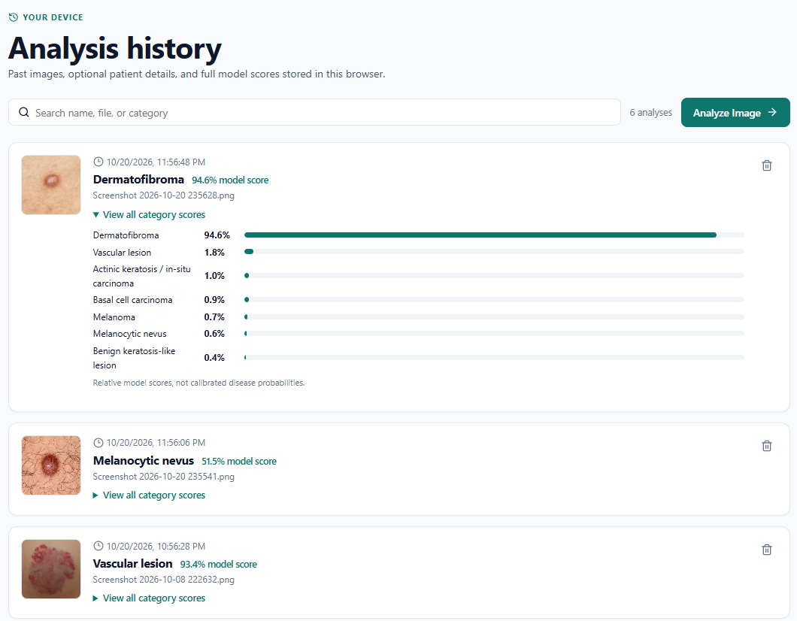
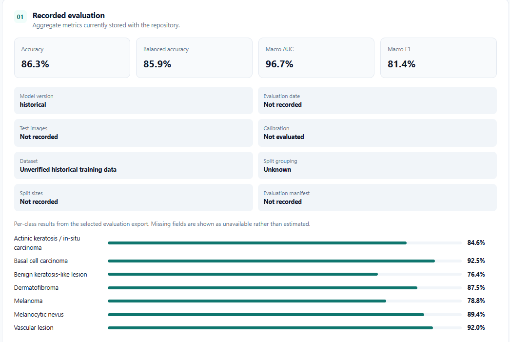
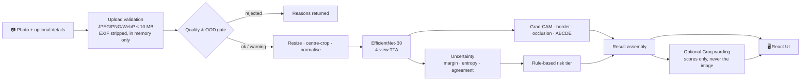

<div align="center">



<br/>

[](https://www.python.org/)
[](https://pytorch.org/)
[](https://fastapi.tiangolo.com/)
[](https://react.dev/)
[](LICENSE)
[](#%EF%B8%8F-important-disclaimer)

**Upload a photo of a skin lesion. Get an explainable, non-diagnostic triage result — scores, uncertainty, visual evidence, and a plain-language path to a clinician.**

[Features](#-features) · [Screenshots](#-screenshots) · [How it works](#-how-it-works) · [Quick start](#-quick-start) · [Results](#-measured-performance) · [Structure](#-project-structure)

</div>

---

## ⚠️ Important disclaimer

> **Lesion Lens is an educational and research prototype. It is not a medical device and does not provide a diagnosis.**
> Model scores are *relative rankings*, not calibrated disease probabilities. A "benign" or "nevus" result is **never** reassurance — melanoma and moles can look alike, and this model misses some melanomas. Always show any changing or worrying lesion to a qualified dermatologist.

---

## ✨ Features

<table>
<tr>
<td width="50%" valign="top">

### 🧠 Classifier
- **EfficientNet-B0** (`timm`), 224 × 224 input, CPU inference
- **7 diagnostic classes** from the HAM10000 label set
- **4-view test-time augmentation** (original, H-flip, V-flip, both)
- Per-view breakdown and consensus shown in the UI

### 🔍 Explainability
- **Grad-CAM** attribution overlay and standalone heatmap
- **Lesion border** outline derived from the activation map
- **32 px patch-occlusion** sensitivity test
- **ABCDE morphology engine** — asymmetry, border, colour variegation, diameter
- 5-mode visualizer: *Original · Lesion Border · Attribution Overlay · Heatmap · Perturbation Patch*

</td>
<td width="50%" valign="top">

### 🛡️ Safety rails
- **Image-quality gate** — rejects/flags tiny, blurry or non-skin images (YCrCb + HSV chroma checks)
- **Uncertainty** from score margin, normalised entropy and view agreement; inconclusive results withhold a confident label
- **Rule-based risk tiers**: *routine monitoring → see a doctor soon → urgent review*, driven by explicit, inspectable rules and reported symptoms

### 🩺 Clinical workflow
- **Clinical AI Copilot** (optional, Groq LLM) for follow-up questions
- **35-image ISIC HAM10000 atlas** with a side-by-side comparison matrix
- **Pre-appointment brief** — print/PDF-ready summary with questions for your dermatologist
- **History** stored in your browser (IndexedDB), searchable and deletable
- Light / dark themes, English and Hindi

</td>
</tr>
</table>

---

## 📸 Screenshots

<table>
<tr>
<td width="50%"><b>Analyze</b> — upload or camera capture, body site and optional context<br/></td>
<td width="50%"><b>Results</b> — lesion border, attribution views and differential ranking<br/></td>
</tr>
<tr>
<td width="50%"><b>Library</b> — dermoscopy hallmarks and side-by-side exemplar matrix<br/></td>
<td width="50%"><b>History</b> — past analyses with full model scores, stored on-device<br/></td>
</tr>
<tr>
<td colspan="2"><b>Research &amp; evidence</b> — recorded evaluation metrics, with missing fields shown as unavailable rather than estimated<br/></td>
</tr>
</table>

---

## 🔬 How it works



**The seven classes**

| Code | Class | Risk group |
|:--:|---|---|
| `mel` | Melanoma | 🔴 Malignant |
| `bcc` | Basal cell carcinoma | 🔴 Malignant |
| `akiec` | Actinic keratosis / SCC in situ | 🟠 Pre-cancerous |
| `bkl` | Benign keratosis-like lesion | 🟢 Benign |
| `nv` | Melanocytic nevus (mole) | 🟢 Benign |
| `df` | Dermatofibroma | 🟢 Benign |
| `vasc` | Vascular lesion | 🟢 Benign |

Age, sex and other optional details **never change the class prediction**. Reported symptoms affect only the risk tier and the guidance notes.

---

## 🚀 Quick start

**Requirements:** Python 3.11+ and Node.js 18+

```bash
git clone https://github.com/somilbuilds/lesion-lens.git
cd lesion-lens

# One command: starts the FastAPI backend (8000) and the Vite frontend (5173)
python start_local.py
```

Or run the services separately:

```bash
# Terminal 1 — backend
python start_backend.py

# Terminal 2 — frontend
cd frontend
npm install
npm run dev
```

Then open **http://localhost:5173**.

<details>
<summary><b>🤖 Enable the Clinical AI Copilot (optional)</b></summary>

<br/>

Copy `.env.example` to `.env` and add a [Groq](https://console.groq.com) key:

```env
GROQ_API_KEY=your_key_here
GROQ_MODEL=openai/gpt-oss-120b
```

Without a key the app falls back to the local reference content and ABCDE cards. When a key is set, the leading class, scores, uncertainty, symptoms and any details you enter are sent to the external service — **the image is not.**

</details>

<details>
<summary><b>🌐 Zero-cost hybrid deployment (laptop compute + Render frontend)</b></summary>

<br/>

Run the PyTorch/OpenCV backend on your own machine and host only the static React frontend on Render. The bridge script:

1. Verifies or starts the local FastAPI backend (`BACKEND_PORT`, default `8000`)
2. Opens a Cloudflare Tunnel (`*.trycloudflare.com`)
3. Uses the Render API to update `VITE_API_BASE_URL` and trigger a build
4. Prints an instant-access URL so you can test before the build finishes

```powershell
.\run_tunnel.ps1                              # PowerShell shortcut
.\run_tunnel.ps1 -Port 8000 -StartFrontend    # custom port + local frontend
python scripts/connect_render.py --port 8000  # or call Python directly
```

Requires `RENDER_API_KEY` (and optionally `CLOUDFLARE_TUNNEL_TOKEN`) in `.env`.

</details>

### 🧪 Tests

```bash
cd backend
python -m pytest tests
```

### 🔌 API

| Method | Endpoint | Purpose |
|:--:|---|---|
| `GET` | `/api/health` | Liveness check |
| `GET` | `/api/model-info` | Model description, classes, stored test results |
| `GET` | `/api/conditions` | Condition reference library |
| `POST` | `/api/analyze` | Analyze an image (multipart) with optional context |
| `POST` | `/api/chat/copilot` | Grounded follow-up chat (needs a Groq key) |

---

## 📊 Measured performance

Two sets of results are stored in the repository and **they disagree**. Both are shown here; treat the lower set as the conservative estimate.

| Metric | Training-log record (`models/metrics.json`) | Served by `/api/model-info` |
|---|:--:|:--:|
| Accuracy | 0.863 | 0.794 |
| Balanced accuracy | 0.859 | 0.744 |
| Macro AUC | 0.967 | 0.943 |
| Macro F1 | 0.814 | 0.69 |
| Test images | not recorded | 1,203 |

**Per-class recall**

| Class | Training-log record | Served record |
|---|:--:|:--:|
| akiec | 0.846 | 0.67 |
| bcc | 0.925 | 0.79 |
| bkl | 0.764 | 0.57 |
| df | 0.875 | 1.00 |
| **mel** | **0.788** | **0.59** |
| nv | 0.894 | 0.88 |
| vasc | 0.920 | 0.71 |

> In the served record, melanoma precision is 0.47 — of 112 true melanomas, 31 were labelled naevus, and 46 naevi were labelled melanoma. This is why the system never states a diagnosis, raises advice tiers on the *melanoma score* even when melanoma is not the top class, and always adds a warning to naevus results.

### Known limitations

- Training data are mostly dermoscopic images (plus Brazilian smartphone photos in one record); performance on other skin tones, cameras and body sites is **unverified**.
- Scores are **not calibrated**; no temperature file is shipped, so temperature is 1.0.
- Grad-CAM, the outline and occlusion show **model sensitivity, not clinical features**.
- The skin-colour check is a simple chroma heuristic and can accept or reject wrongly.
- The condition reference text was drafted by AI from public sources and **must be reviewed by a clinician** before any real-world use.
- Authentication, a database, clinician workflows and regulatory validation are out of scope.

---

## 🗂️ Project structure

```
lesion-lens/
├── backend/
│   ├── app/
│   │   ├── main.py              # FastAPI app, validation, endpoints, Copilot chat
│   │   ├── model.py             # Pre-processing, TTA inference, uncertainty, risk tier, Grad-CAM, occlusion
│   │   ├── vision_features.py   # ABCDE extraction + out-of-distribution guardrail
│   │   ├── reporting.py         # Groq wording / clinical memo with local fallback
│   │   ├── config.py            # Classes, risk groups, thresholds
│   │   └── content/             # Condition reference library
│   └── tests/                   # pytest suite
├── frontend/
│   ├── public/                  # Atlas manifest + exemplar images, research charts
│   └── src/
│       ├── api.ts · history.ts · i18n.ts · imageQuality.ts
│       └── pages/               # Analyze · Results · Library · History · About · Privacy
├── models/                      # Weights + recorded metrics (metrics.json, test_metrics.json)
├── docs/                        # Banner and screenshots
├── scripts/connect_render.py    # Cloudflare Tunnel ↔ Render bridge
├── start_local.py               # One-command launcher
└── skinlesion_train_eval_colab.ipynb
```

---

## 🔒 Privacy

- Images are decoded **in memory** and never written to disk by the backend; EXIF metadata is dropped.
- Analysis history lives only in **your browser's** storage and can be deleted at any time.
- The optional Groq Copilot receives text (scores and details you enter), never the image.

---

## 🛣️ Roadmap

- [ ] Reconcile the two result records: publish evaluation code and the test list, re-evaluate on one documented split
- [ ] Train and test on more diverse data (darker skin tones, more smartphone photos) and report per-source / per-skin-tone metrics
- [ ] Calibrate with temperature scaling and add confidence intervals
- [ ] Complete the small-CNN / ResNet18 / EfficientNet-B0 comparison on one split
- [ ] Replace the Grad-CAM-derived outline with a trained segmentation model
- [ ] Clinician review of the reference content; mobile usability study
- [ ] CI, rate limiting, authentication and monitoring before any deployment beyond a demo

---

## 👥 Team

Built as a mini project for **AI&ML in Healthcare Lab (HAIMLSBL701)**, Department of Computer Engineering, **A.P. Shah Institute of Technology**, University of Mumbai (2026–27), under the guidance of **Prof. Vijaya Bharathi J**.

| Name | |
|---|---|
| Somil Dedhiya | [@somilbuilds](https://github.com/somilbuilds) |
| Uday Dutta | |
| Parth Inamdar | |
| Bhavani Das | |

---

## 🙏 Acknowledgements

[HAM10000](https://doi.org/10.1038/sdata.2018.161) · [PAD-UFES-20](https://doi.org/10.1016/j.dib.2020.106221) · [EfficientNet](https://arxiv.org/abs/1905.11946) · [Grad-CAM](https://arxiv.org/abs/1610.02391) · [timm](https://github.com/huggingface/pytorch-image-models) · [PyTorch](https://pytorch.org/) · [FastAPI](https://fastapi.tiangolo.com/) · [React](https://react.dev/)

## 📄 License

Released under the [MIT License](LICENSE). Not for clinical use.

<div align="center">
<sub>If you or someone you know has a mole or spot that is changing, bleeding or worrying — see a dermatologist. 🩺</sub>
</div>
